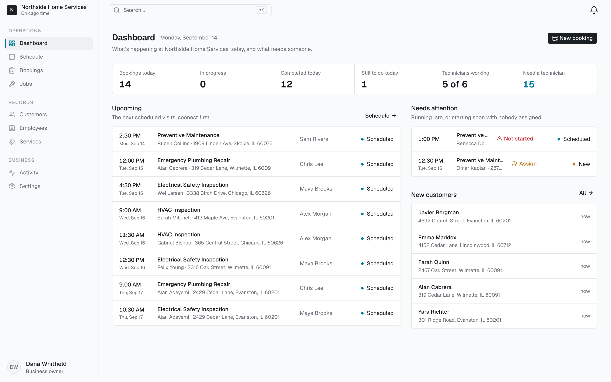
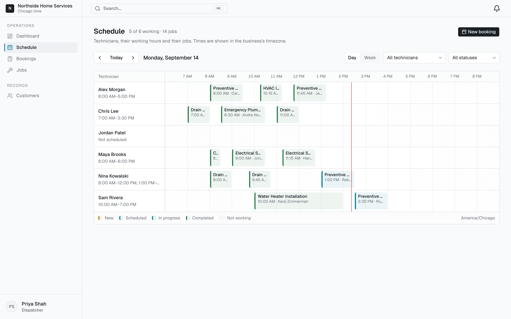
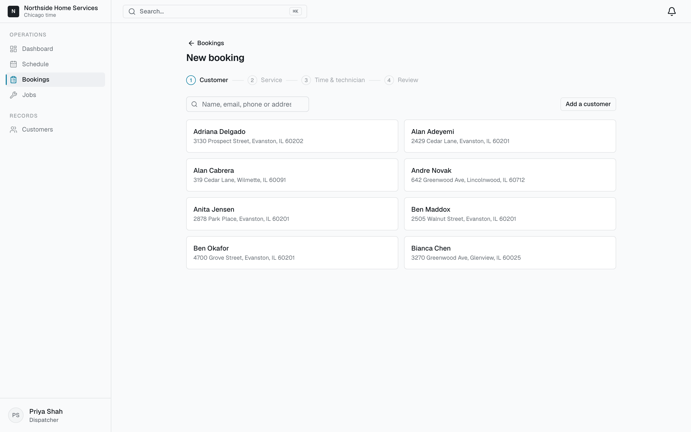
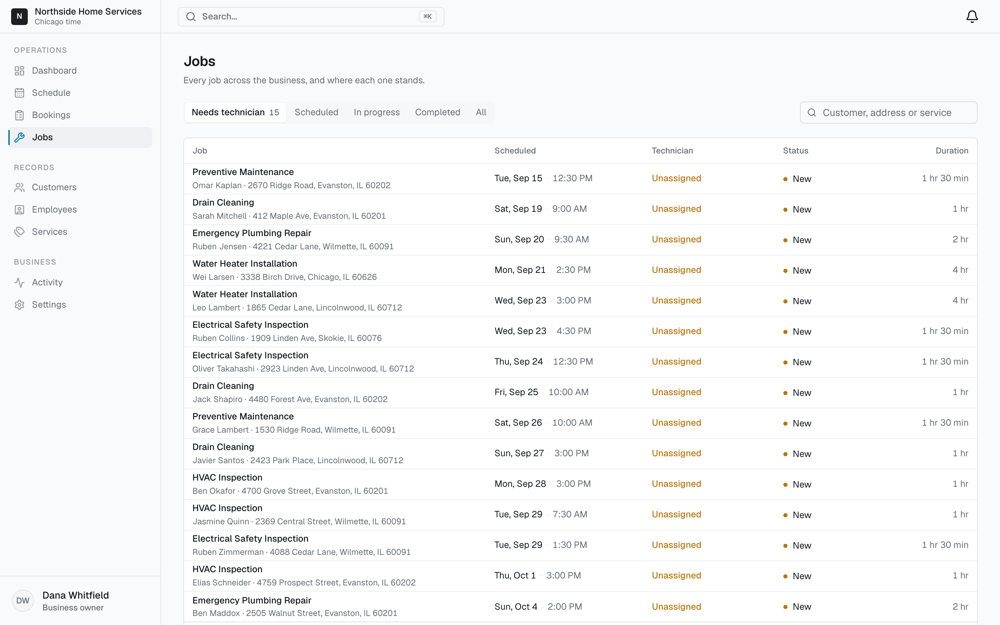
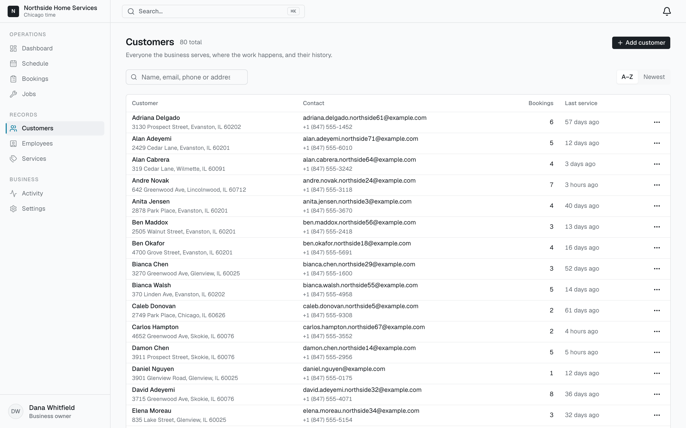
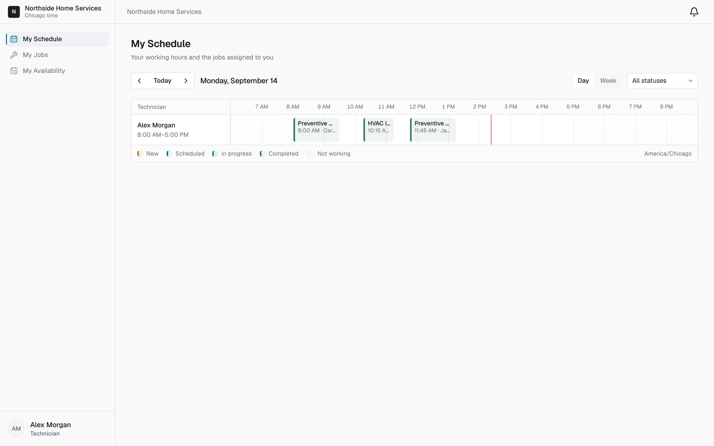
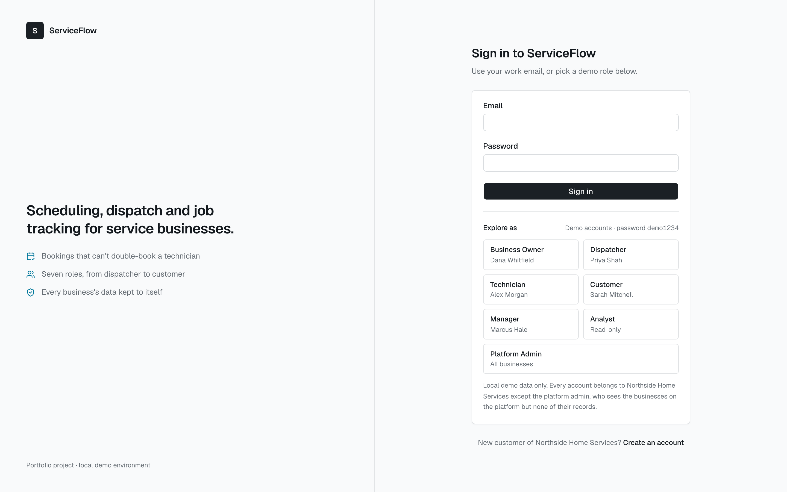

# ServiceFlow

A multi-tenant operations platform for service businesses - plumbers, HVAC
contractors, cleaning companies. Customers request work, dispatchers book it onto
a technician's schedule, technicians carry each job from scheduled to completed,
and owners see the whole business. Many businesses share one deployment without
ever seeing each other's data.

Built with Next.js, React and TypeScript on the frontend; FastAPI, SQLAlchemy 2
and PostgreSQL 16 on the backend; Redis and Celery for background work; Docker
Compose for the whole stack.



## What it demonstrates

- **Seven roles with real permissions.** Platform admin, owner, manager,
  dispatcher, technician, customer and read-only analyst. The API enforces a
  permission table on every route and narrows "own" access in the service layer;
  the interface only shows what the API will allow.
- **Tenant isolation enforced by the database, not just the code.** Every query
  is scoped by the caller's verified membership, and underneath that PostgreSQL
  refuses cross-tenant rows on its own: composite `(organization_id, id)` foreign
  keys and forced row level security on every tenant table, with the API
  connecting as a role that cannot bypass it.
- **Bookings that cannot collide.** A GiST exclusion constraint makes overlapping
  jobs for one technician impossible to store, a partial unique index does the
  same for duplicate open bookings, and the scheduler turns both into a readable
  `409` - "Alex Morgan is already booked from 2:00 PM–3:00 PM" - before the
  database has to.
- **A job lifecycle.** Every booking owns exactly one job: `NEW` until a
  technician is assigned, then `SCHEDULED`, `IN_PROGRESS`, `COMPLETED` or
  `CANCELLED`, with every transition checked by one state machine and recorded in
  an append-only audit log.
- **Background work that survives failure.** Confirmation and reminder emails are
  written to an outbox inside the business transaction and delivered by Celery
  after commit, so a rolled-back booking never sends mail and a broker outage is
  recovered by a periodic sweep. Locally, mail lands in Mailpit.
- **Measured, not claimed.** A benchmark generates thousands of invalid writes and
  fails on a single success; a k6 load test runs an authenticated read/write mix
  over a 25-tenant dataset. The numbers below are generated from the committed
  result files, and a test fails if they drift.

## Results

Tenant isolation ([details](docs/benchmarks.md#tenant-isolation)):

<!-- benchmark:isolation-summary:start -->
| Invalid attempts | Blocked | Unexpected successes | Server errors | Invariant violations |
| ---: | ---: | ---: | ---: | ---: |
| 3,061 | 3,061 | 0 | 0 | 0 |

Alongside the attacks, 128 legitimate control writes succeeded (result: **PASS**, commit `ebc247e`, 2026-09-14T19:46:03+00:00).
<!-- benchmark:isolation-summary:end -->

Load ([details and configuration](docs/benchmarks.md#load-test)):

<!-- benchmark:load-summary:start -->
| Throughput | p50 | p95 | p99 | Error rate (failed requests) | Requests |
| ---: | ---: | ---: | ---: | ---: | ---: |
| 378.8 req/s | 210.0 ms | 531.8 ms | 790.3 ms | 0.00% (0) | 24,131 |

100 concurrent virtual users for 60s, no think time, against 25 tenants, 50,000 bookings and 50,000 jobs. 4 API workers, pool 10 + 5 per worker; peak 61 PostgreSQL connections. Apple M5, 16 GB, PostgreSQL 16.15, Redis 8.10.1; everything on one machine (commit `ebc247e`, 2026-09-14T19:44:27+00:00).
<!-- benchmark:load-summary:end -->

These are single-machine figures from a laptop, with the API, PostgreSQL, Redis
and the load generator sharing its cores. They describe behaviour under
contention, not the capacity of a server.

## Quick start

Requires Docker with Compose.

```bash
git clone https://github.com/idhanth/serviceflow.git
cd serviceflow
docker compose up --build
```

The first start builds the images, runs the migrations and seeds three demo
businesses. Then:

| | |
| --- | --- |
| App | http://localhost:3000 |
| API | http://localhost:8000 (`/health`) |
| Captured email (Mailpit) | http://localhost:8025 |

Check that everything works end to end:

```bash
./scripts/docker-smoke.sh
```

No `.env` is needed for the Docker stack; `docker-compose.yml` carries local-only
development values. For running the API or web app outside Docker, copy
`.env.example` and see [CONTRIBUTING.md](CONTRIBUTING.md).

## Demo accounts

Every account uses the password `demo1234`, and the sign-in page has a one-click
button for each role. They exist only in the local demo database.

| Role | Email | Who | Can |
| --- | --- | --- | --- |
| Platform admin | `admin@serviceflow.demo` | Taylor Brooks | List businesses on the platform - and nothing inside them |
| Owner | `owner@serviceflow.demo` | Dana Whitfield | Everything in the business, including settings and team members |
| Manager | `manager@serviceflow.demo` | Marcus Hale | Run operations, staff and services; read the audit log |
| Dispatcher | `dispatcher@serviceflow.demo` | Priya Shah | Book and assign work, manage customers and availability |
| Technician | `employee@serviceflow.demo` | Alex Morgan | See their own schedule, work their own jobs, set their availability |
| Customer | `customer@serviceflow.demo` | Sarah Mitchell | Request and manage their own bookings |
| Analyst | `analyst@serviceflow.demo` | Kevin Tran | Read operations, records and the audit log; change nothing |

All of these belong to **Northside Home Services** (Chicago). Two more businesses,
**Harbor Plumbing & Heating** (`harbor.owner@serviceflow.demo`) and **BrightSpace
Cleaning Co.** (`brightspace.owner@serviceflow.demo`), exist so tenant isolation
can be seen from the other side.

## Screenshots

| | |
| --- | --- |
|  Day schedule for dispatchers: technicians, working hours and jobs in the business's timezone |  Booking wizard: customer, service, a time and an available technician, review |
|  Jobs, starting with the work that still needs a technician |  Customers with contact details and service history |
|  A technician sees only their own day |  Sign-in with a demo account for every role |

## Architecture

```
Browser ──▶ Next.js server ──▶ FastAPI ──▶ service layer ──▶ PostgreSQL 16
            httpOnly cookie     permission    business rules    constraints, RLS
            token attached      checks              │
            server-side                        outbox rows (same transaction)
                                                    │ after commit
                                                    ▼
                                    Redis ──▶ Celery worker ──▶ SMTP (Mailpit)
                                                 Celery beat: reminders, outbox sweep
```

The browser never holds the API token: sign-in stores it in an httpOnly cookie
and the Next.js server attaches it. Tenant scope is derived from the caller's
membership and bound into PostgreSQL for the transaction, so a query that forgets
its tenant filter returns nothing rather than another business's rows.

[docs/architecture.md](docs/architecture.md) explains where each guarantee lives;
[docs/PRD.md](docs/PRD.md) is the product specification.

| Layer | Technology |
| --- | --- |
| Frontend | Next.js 16 (App Router), React 19, TypeScript, Tailwind CSS 4, TanStack Query |
| API | FastAPI, Pydantic v2, SQLAlchemy 2, Alembic |
| Database | PostgreSQL 16 - exclusion constraints, composite foreign keys, row level security |
| Background work | Celery with Redis; Celery beat for reminders and the outbox sweep |
| Email and files | SMTP (Mailpit locally); S3-compatible object storage (MinIO locally) |
| Testing | pytest against real PostgreSQL and Redis, Playwright, k6 |
| Delivery | Docker Compose, GitHub Actions |

## Testing

```bash
# backend: unit, integration, row level security, permissions, concurrency
cd apps/api && uv sync --extra dev && uv run pytest

# frontend
cd apps/web && npm ci && npx eslint src e2e && npx tsc --noEmit && npm run build

# browser tests against the running Docker stack
./scripts/e2e.sh

# benchmarks (need PostgreSQL 16 and Redis; see docs/benchmarks.md)
./scripts/bench-isolation.sh
./scripts/load-test.sh run 100 60s
```

The backend tests run against real PostgreSQL and Redis, with the schema built by
the real migrations - the booking guarantees are database constraints, so a test
database without them would prove nothing. Concurrency tests release real threads
from a shared barrier to race for the same technician and slot.

CI runs on every push: backend lint, types, migrations and tests against
PostgreSQL 16 and Redis; the tenant isolation benchmark; the frontend lint, type
check and production build; and the full Docker Compose stack through the smoke
test and the Playwright suite.

## Repository layout

```
apps/api          FastAPI application, Alembic migrations, pytest suite
apps/web          Next.js application and Playwright suite
benchmarks        isolation benchmark, load dataset and k6 scenario, committed results
docker            database initialisation for the Compose stack
docs              product requirements, architecture, benchmarks, screenshots
scripts           smoke test, browser tests and benchmark runners
```

## Known limitations

- **Not deployed.** It runs locally through Docker Compose; there is no hosted
  demo and no production traffic behind any number here.
- **Local development authentication.** Sign-in issues the API's own signed
  tokens against Argon2id password hashes. A production deployment would add
  email verification, password reset and multi-factor authentication, or use an
  identity provider.
- **Single database.** All tenants share one PostgreSQL database, isolated by
  keys, policies and scoping. There are no read replicas or sharding.
- **At-least-once email.** A provider timeout after a successful send can produce
  a duplicate; the outbox guarantees delivery is attempted and retried, not that
  it happens exactly once.
- **Demo data is synthetic.** The businesses, people and addresses are invented.

## License

[MIT](LICENSE)
