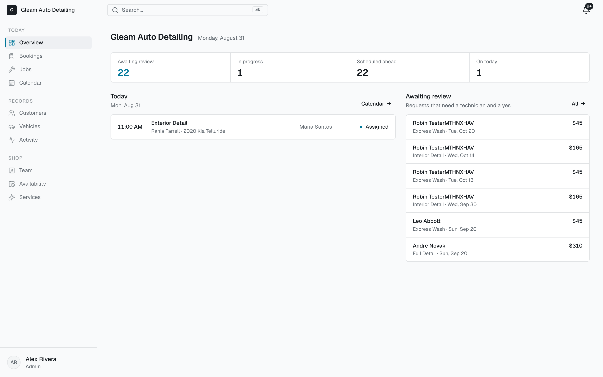
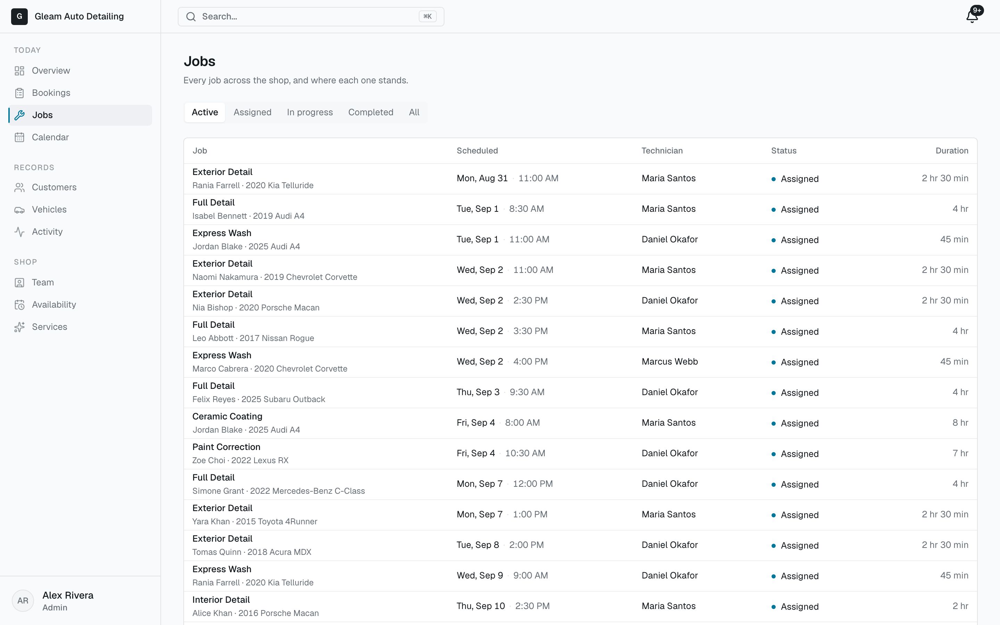
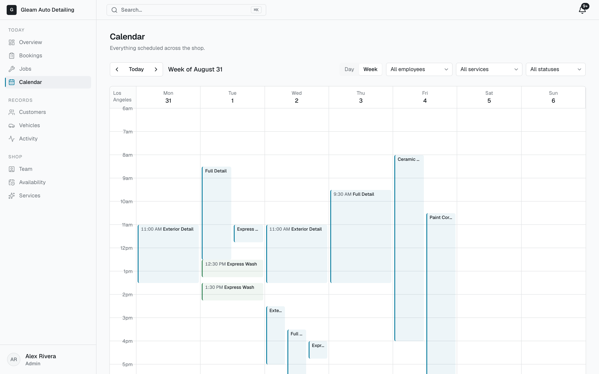
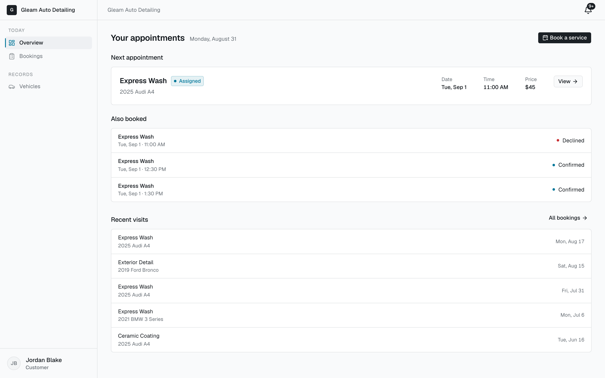

# ServiceFlow

Operations platform for small service businesses - bookings, scheduling, job
assignment and progress tracking. The reference deployment is an auto detailing
shop; the domain model is business-type agnostic.

**Status: all 10 phases built. Not yet deployed.** The production deployment is
written and scripted end to end — systemd units, reverse proxy, CI, CD and an
acceptance test that drives the real workflow against a live URL — but it has
not been provisioned, because doing so needs accounts only the owner can create.
Nothing below describes a running service, and there is no live URL to give yet.
[docs/deployment.md](docs/deployment.md) is the runbook; this section will carry
the link once it is genuinely live.

Everything else is real and verifiable on your own machine: 28 Playwright tests
drive a browser through all three roles, 81 tests hold real threads against real
PostgreSQL and Redis, and the load numbers below were measured, not estimated.
See [Roadmap](#roadmap).

## Stack

| Layer | Choice |
| --- | --- |
| Frontend | Next.js 16, React 19, TypeScript, Tailwind 4, shadcn/ui (Base UI), TanStack Query |
| Backend | FastAPI, SQLAlchemy 2, Alembic, Pydantic v2 |
| Database | PostgreSQL 16 |
| Cache / queue | Redis — Celery broker and realtime pub/sub |
| Email | Provider-agnostic — MailPit over SMTP locally, Resend in production |
| Object storage | S3-compatible — MinIO locally, Cloudflare R2 in production |
| Auth | Pluggable - local tokens by default, Clerk by configuration ([ADR 0001](docs/adr-0001-authentication-provider.md)) |
| Hosting | Vercel (frontend); one always-free ARM VM running uvicorn, Celery worker and beat under systemd behind Caddy |
| CI/CD | GitHub Actions — lint, types, pytest and Playwright against real services; deploy over SSH |

## Quick start

```bash
source scripts/env.sh
./scripts/services.sh start          # PostgreSQL, Redis, MinIO and MailPit

cd apps/api
cp ../../.env.example ../../.env     # then set DATABASE_URL user + JWT_SECRET
uv sync --extra dev
uv run alembic upgrade head
uv run python -m serviceflow.db.seed
uv run uvicorn serviceflow.main:app --port 8000

# in a second shell
cd apps/web && npm install && npm run dev

# in a third shell — background jobs and the reminder scheduler
./scripts/worker.sh
```

Captured email is readable at http://localhost:8025.

Open http://localhost:3000.

With Docker available, `docker compose up` replaces `scripts/services.sh`.
Full details in [docs/local-development.md](docs/local-development.md).

## Demo accounts

Password for all three: `demo1234`

| Role | Email |
| --- | --- |
| Admin | `admin@serviceflow.demo` |
| Employee | `employee@serviceflow.demo` |
| Customer | `customer@serviceflow.demo` |

The sign-in page has a one-click button for each, and `/signup` creates a fresh
customer account if you'd rather walk the flow from the beginning.

The seed creates the organization's catalog and book of business: 6 services,
5 employees (each with their own weekly schedule and some time off), 75 customers,
100 vehicles, 250 bookings and 199 jobs (180 of them completed), per PRD 49. It is
deterministic and idempotent — rerunning it changes nothing — and it schedules
around working hours, so no seeded job overlaps another. It also adds 68 job
notes, 24 photos (uploaded to object storage for real) and a short notification
history for the demo customer.

## Screenshots

The shop's day, for the person who has to run it.


*What needs a decision right now: today's schedule on the left, the queue
waiting on a yes on the right. No greeting, no invented growth metrics.*


*Every job in the shop as a table, because the task is comparing rows — who is
working, on what, when, for how long. Not a card per job.*


*The week in the shop's timezone, which is labelled rather than assumed.
Overlapping work splits into lanes instead of drawing over itself.*


*The same system, seen by a customer: their next appointment, their history, and
nothing about anyone else's — served by the same API, scoped by role.*

More, including dark mode and the 390px layouts, in
[ADR 0009](docs/adr-0009-interface-design.md).

## Architecture

```
Next.js  ->  route handlers (/api/proxy)  ->  FastAPI  ->  service layer  ->  PostgreSQL
                                                              |
                                                    notifications (outbox)
                                                        |            |
                                             Celery worker      Redis pub/sub
                                                  |                  |
                                            email provider    SSE -> browser
```

The interface is documented in [ADR 0009](docs/adr-0009-interface-design.md):
a 14px working size with page titles at 20px, near-black primary actions with a
single teal accent spent only on selection and live work, six status meanings
with one colour each, 6px radii, 44px table rows, and no dependency added to
achieve any of it. Phones get the operational tables as stacked lists rather
than a horizontal scroll.

Three decisions worth knowing up front:

- **The session token never reaches client JavaScript.** It is stored in an
  httpOnly cookie and attached server-side by the proxy route handler, so an XSS
  bug cannot exfiltrate it.
- **Tenant scope is derived, never supplied.** `CurrentUser.organization_id`
  comes from a verified active membership. A caller can ask for an organization
  via `X-Organization-Id`, but a mismatch is refused, and a foreign organization
  is indistinguishable from a nonexistent one.
- **History is never deleted.** Services deactivate and vehicles archive rather
  than disappearing, and `bookings.vehicle_id` / `service_id` are `ON DELETE
  RESTRICT`, so a past appointment can always still say what was done to which
  car ([ADR 0002](docs/adr-0002-phase2-entity-decisions.md)).
- **A confirmed booking always has exactly one job.** The booking row is locked
  for the confirmation transaction, the state machine refuses a second confirm,
  and `jobs.booking_id` is unique — three independent guards, all tested
  ([ADR 0003](docs/adr-0003-phase3-booking-workflow.md)).
- **An employee can never hold two overlapping jobs.** A PostgreSQL exclusion
  constraint over `(employee_id, tstzrange(...))` makes it impossible whatever the
  application does, and a per-employee advisory lock turns the race into a clean
  409 instead of a constraint violation
  ([ADR 0004](docs/adr-0004-scheduling-concurrency.md)).
- **Emails are an outbox, not a side effect.** Notification rows are written
  inside the business transaction and dispatched only after it commits, so a
  rolled-back booking can never send mail — and a broker outage right after the
  commit is recovered by a periodic sweep rather than losing the message.
  Delivery is at-least-once, deliberately, and the duplicate window is documented
  ([ADR 0006](docs/adr-0006-async-infrastructure-and-realtime.md)).
- **Realtime events carry no record content.** An SSE envelope names what changed
  and who may know; the client refetches. A dropped event is therefore harmless,
  and a reconnecting client is correct again without replaying anything.
- **Photo bytes never pass through the API, and the bucket is never public.**
  The browser uploads to a presigned POST whose signed policy pins the content
  type and a 10 MB ceiling; the API then verifies the stored object before
  writing any metadata, so a `JobPhoto` row cannot describe a file that was not
  uploaded. Reads are short-lived presigned GETs
  ([ADR 0005](docs/adr-0005-object-storage-and-notifications.md)).
- **A resubmitted booking cannot become two.** `Idempotency-Key` is claimed on a
  unique constraint inside the booking's own transaction, so concurrent requests
  with one key produce one booking: the loser of the race replays the winner's
  response. A changed payload under a used key is a 409, not a silent second
  appointment ([ADR 0007](docs/adr-0007-idempotency-audit-and-limits.md)).
- **The audit trail cannot be rewritten.** A `BEFORE UPDATE OR DELETE` trigger
  rejects both statements on `audit_logs`, so "who changed this booking" is not a
  question the application can answer differently later. Entries are staged in
  the business transaction, and their metadata is a summary — never a note's
  contents, a token or a presigned signature.
- **Rate limits are atomic across processes.** One Lua script does INCR, EXPIRE
  and TTL in a single Redis round trip. Signup and login fail *closed* if Redis
  is unreachable; authenticated limits fail open, because a limiter outage should
  not become a product outage.
- **Failures leak nothing.** One error envelope, a stable code, a sentence for a
  person and a request id that also appears in the logs. No exception text, SQL,
  stack frame or filesystem path reaches a client, and a rejected password is
  never echoed back in a validation message.

## Deployment

Not provisioned. Everything needed to provision it is in the repository, and
[docs/deployment.md](docs/deployment.md) is the step-by-step runbook.

The design target was a production deployment that costs nothing and cuts no
corners to get there:

```
browser ──HTTPS──▶ Vercel (Next.js)  ──HTTPS, X-Proxy-Token──▶  Oracle Cloud VM
                   session cookie                                Caddy (TLS)
                   set here                                      uvicorn x2
                                                                 celery worker
                                                                 celery beat
                                                                      │
                                          Neon · Upstash · Cloudflare R2 · Resend
```

The browser only ever talks to the Next.js server, which forwards to the API
server-side. That is what keeps the session cookie `Secure`, `HttpOnly` and
first-party without any cross-origin compromise — the constraint that decided
the whole layout.

**Why the API is not serverless.** Celery beat is a clock that has to keep
running, and workers have to outlive the request that queued their work. A
request-scoped runtime would leave the queue with no consumer, so the API,
worker and beat run as three systemd units on one small always-free ARM VM.
Measured footprint is about 250 MB RSS for all three.

**The forwarded address is made unforgeable, not merely trusted.** The API
identifies unauthenticated callers by IP for rate limiting, so a client that
could reach it directly could rewrite `X-Forwarded-For` and walk past the login
limiter. uvicorn binds to loopback, the firewall opens only 80 and 443, and the
frontend sends a shared `X-Proxy-Token` that both Caddy *and* the API check
independently — so a mistake in the edge config cannot quietly expose the
service. `TRUSTED_PROXY_COUNT=2` then names the exact hop to believe.

**Pool sizing is arithmetic that is written down.** Two uvicorn workers plus one
Celery worker is `3 × (5 + 5) = 30` connections against the provider's ceiling.
`DATABASE_POOL_TIMEOUT` stays at 5s so that saturation keeps degrading the way
phase 8 measured — a deliberate `503` with `Retry-After`, never a generic 500.

**Nothing can seed a live database by accident.** The seed writes a synthetic
book of business — 80 customers, 266 bookings — into whatever database it is
pointed at, so no service unit, no deploy step and no HTTP route can reach it.
Seeding a deployment is a manual act against a database you name.

CI runs on every push: Ruff, `ruff format --check`, mypy strict and the full
pytest suite against real PostgreSQL, Redis, MinIO and MailPit service
containers; ESLint, `tsc --noEmit` and a production build for the frontend; then
the Playwright suite against the whole stack. Infrastructure is never swapped
for mocks to make CI convenient. Deployment is a separate workflow that stays
inert until its secrets exist.

Once deployed, `./scripts/smoke.sh <url>` is the acceptance test: it signs in as
all three roles, books into a slot it finds free on the technician's real
calendar, replays the request to prove idempotency, confirms it, works the job,
checks that an internal note never reaches the customer, that the presigned
upload is short-lived and points at the configured bucket, and that the Celery
worker actually drained the email outbox.

## Testing

```bash
cd apps/api && uv run pytest        # 538 tests, ~90s
cd apps/web && npx tsc --noEmit     # types
./scripts/e2e.sh                    # 28 Playwright tests against the real stack
./scripts/load.sh mixed 100 60s     # k6, against an isolated load database
```

The suite is shaped like a pyramid and each layer answers a different question
([ADR 0008](docs/adr-0008-quality-strategy.md)):

| Layer | What it proves | Where |
| --- | --- | --- |
| Unit | Windows, transitions, ranking, validation, timezones | `tests/test_units.py`, `test_state_machine.py`, `test_availability_logic.py` |
| Integration | Routes, services, tenant isolation, transactions | most of `apps/api/tests` |
| Concurrency & stress | 81 tests: races, contention, idempotency, limiter | `test_concurrency.py`, `test_stress_*.py` |
| Failure | Dependencies breaking, and recovering | `test_failure_paths.py`, `test_rate_limiting.py`, `test_email_delivery.py` |
| End-to-end | The product, in a browser, for all three roles | `apps/web/e2e` |
| Load | What it does under 100 and 500 concurrent users | `load/`, `scripts/load.sh` |

Infrastructure is exercised, not mocked: photo tests upload to MinIO for real,
email tests deliver over SMTP to MailPit and assert against its mailbox, realtime
tests publish through Redis, and one test runs an actual Celery worker as a
separate process. `./scripts/services.sh start` has to be running.

The schema under test is built by running the real migrations, not
`metadata.create_all` — the scheduling guarantee is a database constraint, so a
test database without it would prove nothing.

Coverage includes tenant isolation on every entity, per-organization roles, the
customer-vs-customer boundary, server-derived booking windows, transactional job
creation and rollback, every legal and illegal state transition, overlap
detection (adjacent, contained, partial), availability and override precedence,
timezone and daylight-saving boundaries, deterministic ranking — and the
concurrency suite below.

**Concurrency and stress (PRD 52).** Real threads against real PostgreSQL and
real Redis, released from a shared barrier so the race actually happens:

```bash
uv run pytest -m "concurrency or stress"    # 81 tests
```

Twelve simultaneous overlapping confirmations leave exactly one winner and
eleven clean refusals; six adjacent ones all succeed; four employees under
twelve bidders end up with exactly four jobs and no overlap. Twenty callers
sharing one idempotency key produce one booking, one audit entry and one
notification — not twenty. A hundred callers against a limit of twenty leave
exactly twenty allowed.

**End-to-end (PRD 53).** Playwright drives the real browser against the real
stack — PostgreSQL, Redis, MinIO, MailPit and a Celery worker, none of them
mocked. A photo upload in these tests is a presigned POST to MinIO followed by
the API verifying the stored object; an email assertion reads MailPit's mailbox.

```bash
./scripts/services.sh start && ./scripts/e2e.sh
```

The cross-role test follows one booking from a customer's request, through an
admin's confirmation, to an employee starting, photographing and finishing the
work — then checks the customer sees the visible note and never the internal
one, that the email arrived, and that the admin's Activity feed tells the whole
story.

**Load (PRD 54).** k6 against an isolated `serviceflow_load` database, so a run
cannot touch the demo data. Measured on one laptop — a single PostgreSQL with
`max_connections = 100`, with the API, the database and k6 all sharing it:

| Scenario | Concurrency | Throughput | p50 | p95 | p99 | Errors |
| --- | --- | --- | --- | --- | --- | --- |
| Read-heavy | 100 | 367 req/s | 250 ms | 331 ms | 376 ms | 0% |
| Mixed | 100 | 302 req/s | 277 ms | 513 ms | 640 ms | 0% |
| Write-heavy | 100 | 48 req/s | 442 ms | 5.4 s | 10.3 s | 4.2% |
| Read-heavy | 500 | 490 req/s | 94 ms | 5.2 s | 15.2 s | 75% (shed as 503) |

At 100 concurrent users the system is comfortable. At 500 this machine is not —
`max_connections` is the ceiling, not the application — and what it does instead
is refuse the excess with `503` and `Retry-After` while staying correct. After
every run, `load/invariants.sql` asks the database whether any idempotency key
produced two bookings, whether any confirmed booking lacks exactly one job,
whether any employee was double-booked and whether anything crossed a tenant
boundary. After 3,834 bookings created under load: all zero, and 3,834 keys
mapping to 3,834 distinct bookings.

## Known limitations

Stated plainly, because a portfolio project that claims none is not being honest.

- **It is not deployed.** No uptime, no production traffic, no real users and no
  production throughput figures exist, and none are claimed anywhere here.
- **The load numbers are from one laptop**, with the API, PostgreSQL and k6 all
  competing for the same cores. They characterise behaviour under contention;
  they are not a capacity estimate for any server.
- **The planned production host is a single free-tier VM.** No redundancy, no
  failover, and Oracle's Always Free tier may reclaim instances it considers
  idle. It is the right trade for a demo and the wrong one for a business.
- **Email is at-least-once, not exactly-once.** A provider timeout after a
  successful send can produce a duplicate. The outbox guarantees delivery is
  attempted and retried, not that it happens precisely once.
- **The demo's auth is the local token provider**, enabled deliberately with
  `PUBLIC_DEMO_MODE` so that published credentials work. A real tenant would set
  `AUTH_PROVIDER=clerk`; the API refuses to start otherwise in production.
- **Single-region, single-database.** No read replicas, no sharding, no
  multi-region story. Tenant isolation is enforced per-query and tested, but
  every tenant shares one database.
- **The seed's history is synthetic.** 250 bookings and 199 jobs are generated
  demo data — a plausible book of business, not a real one.

## Roadmap

| Phase | Scope | Status |
| --- | --- | --- |
| 1 | Foundation: repo, auth, organizations, roles, migrations | done |
| 2 | Customers, employees, services, vehicles | done |
| 3 | Booking workflow, assignment, job lifecycle | done |
| 4 | Availability, conflict detection, transaction safety, calendar | done |
| 5 | Photos, notes, search, filtering, notifications | done |
| 6 | Redis, Celery, email, realtime | done |
| 7 | Idempotency, audit logs, rate limiting, observability | done |
| 8 | Integration, E2E, concurrency and load tests | done |
| 9 | UI polish, responsive, dark mode | done |
| 10 | CI/CD, production infrastructure, monitoring | built, not deployed |

Full specification: [docs/PRD.md](docs/PRD.md).
